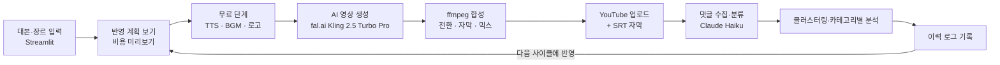

# AI 영상 생성 · 댓글 피드백 자동 반영 파이프라인


https://youtu.be/IznWBG9Pa6g?si=qrW45xPYjKKoTJCE

https://youtu.be/F9Zzw-yBKzg?si=1sqkIeR1it5rBKhI

https://youtu.be/bmYC1haMQ_Q?si=ZoxErzsJHkFQqon-

https://youtu.be/KEmrAhV5xjQ?si=XdHMO4kpuiKI-6O-

대본과 장르를 입력하면 AI 영상을 만들어 YouTube에 올리고, **시청자 댓글에서 건설적인 피드백을 골라 다음 영상에 자동으로 반영**하는 범용 파이프라인입니다.
캡스톤디자인(졸업작품) 프로젝트이며, 국립군산대학교 임베디드소프트웨어학과 홍보영상을 사례로 검증했습니다.

- 개발: 박기안
- 스택: Python, Streamlit, fal.ai(Kling 2.5 Turbo Pro), edge-tts, ffmpeg, YouTube Data API, Claude Haiku, ko-sroberta + KMeans

---

## 목차

1. [프로젝트 배경과 목표](#1-프로젝트-배경과-목표)
2. [전체 구조](#2-전체-구조)
3. [설계 원칙](#3-설계-원칙)
4. [사용한 기술과 선택 이유](#4-사용한-기술과-선택-이유)
5. [개발 과정](#5-개발-과정)
6. [모듈별 설명](#6-모듈별-설명)
7. [피드백 반영 방식](#7-피드백-반영-방식)
8. [실험 결과](#8-실험-결과)
9. [한계와 앞으로의 계획](#9-한계와-앞으로의-계획)
10. [실행 방법](#10-실행-방법)

---

## 1. 프로젝트 배경과 목표

AI 영상 생성 도구가 빠르게 발전했지만, **완성된 영상에 대한 시청자 반응을 다음 제작에 반영하는 일은 여전히 사람이 직접 읽고 판단**해야 합니다. 느리고 일관성도 떨어집니다. 이 프로젝트는 그 반복 과정을 자동화합니다.

**하려는 일**

1. 사용자가 장르와 대본을 입력하면 AI 영상 생성용 프롬프트를 자동 구성한다.
2. AI 영상 클립을 만들고 나레이션·자막·배경음악·로고를 합성해 영상을 완성한다.
3. YouTube Data API로 업로드하고 댓글을 수집한다.
4. 댓글 중 **구체적인 개선 제안이 담긴 건설적 피드백**만 선별한다. 어조(긍정/부정)와는 무관하고, 스팸·악성·무관 댓글은 제외한다.
5. 비슷한 피드백을 묶어 많이 언급된 개선 방향부터 반영한다.
6. 반영 결과로 다음 영상을 다시 만들고, **어떤 피드백이 어떻게 반영됐는지 이력**을 남긴다.
7. 반복 제작(3회 이상)으로 피드백 반영률을 측정한다.

**특정 AI 엔진에 종속되지 않게** 만드는 것을 설계 목표로 삼았습니다. 영상 생성 서비스는 바뀔 수 있기 때문입니다 (5장 참고).

---

## 2. 전체 구조



한 바퀴를 **사이클(cycle)** 이라 부르고, 사이클마다 부모 영상(`parent_video_id`)을 기록해 어떤 영상에서 파생됐는지 추적합니다.

### 폴더 구조

```
app.py                  Streamlit 화면 (입력, 반영 계획 보기, 생성 실행, 재시도)
pipeline/runner.py      사이클 계획·실행 (plan_cycle, run_generation_cycle)
video/                  영상 생성 어댑터 (mock / fal / luma)
compose/                ffmpeg 합성, 자막, TTS, BGM, 설정(settings)
feedback/               댓글 분류, 클러스터링, 카테고리별 분석 (rewriter)
youtube/                업로드, 댓글 수집, OAuth
input/                  대본 파싱, 나레이션·BGM·로고 관리 (asset_store)
data/clip_cache/        생성한 클립 캐시
data/logs/              사이클 이력(pipeline_history.jsonl), 댓글 로그
assets/                 나레이션 문구, 로고, 배경음악
```

---

## 3. 설계 원칙

### 3-1. 어댑터 패턴으로 AI 엔진 교체 가능하게
영상 생성과 TTS는 모두 어댑터 뒤에 숨겼습니다. 환경변수로 구현체를 고릅니다.

| 대상 | 환경변수 | 선택지 |
|---|---|---|
| 영상 생성 | `VIDEO_GEN_PROVIDER` | `mock` / `fal` / `luma` |
| 음성 합성 | `TTS_PROVIDER` | `mock` / `edge` |

각 어댑터는 같은 인터페이스(영상: `cache_id()`, `cost_per_clip()` 등, TTS: `synthesize(...)`)를 구현합니다. `mock`은 비용 없이 전체 흐름을 테스트하는 데 씁니다.

### 3-2. 돈이 드는 단계는 마지막에, 무료 단계는 먼저
AI 영상 생성은 호출할 때마다 비용이 듭니다. 그래서 순서를 정했습니다.

1. **계획 미리보기**: 어떤 장면을 새로 만들지, 몇 개이고 예상 비용이 얼마인지 보여준다 (무료).
2. **무료 단계 먼저**: 나레이션(TTS), 배경음악, 로고를 준비한다. 여기서 실패하면 영상 비용이 나가지 않는다.
3. **유료 생성**: 캐시에 없는 장면만 생성한다.

### 3-3. 클립 캐시
프롬프트와 생성 설정을 해시(`sha256` 앞 24자)로 만들어 `data/clip_cache/{해시}.mp4`에 저장합니다. 같은 프롬프트는 다시 만들지 않고 재사용하며, 한 번에 새로 만드는 클립 수에도 상한(`MAX_NEW_CLIPS`, 기본 6)을 둡니다.

### 3-4. 피드백은 종류별로 다르게 처리
모든 피드백을 "영상 다시 만들기"로 처리하면 비용도 크고 결과도 불안정합니다. 피드백을 종류로 나누고, **합성 단계에서 바꿀 수 있는 것은 영상을 다시 생성하지 않고** 처리합니다 (7장).

### 3-5. 사람이 확인하는 지점
LLM 분류는 틀릴 수 있어서, 생성 전에 **"반영 계획 보기"** 에서 사람이 항목별로 확인합니다. 나레이션 문구 수정은 AI가 제안만 하고 **체크한 것만 적용**됩니다.

### 3-6. 대본에는 피드백을 넣지 않는다
피드백은 대본이 아니라 **YouTube 댓글로만** 들어옵니다. 사람이 대본에 몰래 반영하면 자동 반영 실험의 의미가 없기 때문입니다.

---

## 4. 사용한 기술과 선택 이유

| 영역 | 사용 기술 | 이유 |
|---|---|---|
| 화면·서버 | Python, Streamlit | 프론트와 백엔드를 한 언어로 빠르게 구현. 혼자 개발하기에 적합 |
| AI 영상 생성 | fal.ai 큐 REST API, Kling 2.5 Turbo Pro | 초당 과금($0.07/초, 5초 클립 $0.35)이라 비용 예측이 쉽고, 여러 모델을 같은 형태로 호출 가능 |
| 음성(TTS) | edge-tts | 무료, 한국어 남/여 음성 제공 (`ko-KR-InJoonNeural`, `ko-KR-SunHiNeural`) |
| 영상 합성 | ffmpeg (imageio_ffmpeg) | 장면 연결, 전환, 자막 오버레이, 음악 믹스를 코드로 제어 |
| 업로드·댓글 | YouTube Data API (OAuth 데스크톱 앱) | 공식 API. `youtube.upload`, `youtube.force-ssl` 범위로 영상·자막 업로드 |
| 댓글 분류 | Claude Haiku | 건설적 피드백 선별을 LLM 기반으로 구현 (모델 파인튜닝 대신) |
| 클러스터링 | ko-sroberta 임베딩 + KMeans (10 클러스터) | 한국어 문장 임베딩으로 비슷한 의견을 묶음 |
| 피드백 분석 | LLM + 키워드 규칙(대체 경로) | LLM 실패 시에도 기본 분류가 가능하도록 |
| 저장 | JSONL 이력, 파일 캐시 | 사이클별 변경 내용을 그대로 추적 |

---

## 5. 개발 과정

### 5-1. 설계와 준비
- 선행 조사: AI 영상 생성 도구, YouTube API, 한국어 댓글 분석 방식을 조사해 운영계획서를 작성했습니다.
- 한국어 댓글 분석은 NLP 모델 파인튜닝과 LLM 분류 중에서 **LLM 기반 분류**를 택했습니다. 개발 기간이 짧고, 카테고리를 자주 늘려야 해서 프롬프트로 바꾸는 쪽이 유연했습니다.
- 프롬프트는 모델 학습 대신 **구조화된 프롬프트 설계**(스타일 + 장면별 지시 + 금지 사항)와 피드백 → 변경 규칙 매핑으로 다루었습니다.

### 5-2. 영상 생성 서비스 선정: Luma → Mock → fal.ai
1. **Luma API**로 먼저 시도했지만 서버 에러(500)가 계속 나서 막혔습니다.
2. 서비스를 확정하기 전까지 **MockAdapter**로 대체해, 영상 생성과 무관한 나머지(업로드, 댓글 수집, 피드백 분류, 반영)를 먼저 개발했습니다. 어댑터 패턴을 쓴 덕분에 가능했던 방식입니다.
3. 이후 **fal.ai**로 확정해 어댑터만 추가했고, 모델은 Kling 2.5 Turbo Pro를 사용합니다.

### 5-3. YouTube 연동
- Google Cloud 프로젝트 생성 → YouTube Data API 활성화 → OAuth 동의 화면 → 데스크톱 앱 OAuth 클라이언트(`client_secret.json`) 설정.
- 영상 업로드와 댓글 수집 구현. 이후 자막(SRT) 업로드도 같은 인증 범위로 추가했습니다.
- 일일 **업로드 한도**에 걸려 실험 간격이 필요했습니다. 그래서 업로드 실패 시 영상과 정보를 `pending_upload.json`에 보관하고, 화면의 **"업로드 다시 시도"** 버튼으로 비용 없이 재시도하도록 만들었습니다.

### 5-4. 합성 파이프라인
- 장면별 mp4를 만들고(크기·fps 통일, 전환, 자막·로고 오버레이, 나레이션 지연), 하나로 이어 붙인 뒤 배경음악을 믹스합니다.
- 나레이션, 배경음악, 로고를 **화면에서 직접 편집**할 수 있도록 영상 구성 요소 설정(대본/나레이션, BGM 업로드·선택, 로고 업로드)을 추가했습니다.
- edge-tts가 403 오류를 낼 때는 `pip install -U edge-tts`로 해결했습니다.

### 5-5. 피드백 분석의 확장
처음에는 영상 내용 위주의 소수 카테고리만 있었고, 실제 댓글을 받으며 **합성 단계에서 무료로 반영 가능한 카테고리를 계속 늘렸습니다**.

- 초기: 영상 내용, 장면 전환, 배경음악/나레이션 크기, 자막 크기, 로고 등
- 확장: 화면 보정, 자막 표시 방식(YouTube 자막), 목소리 종류, 자막 모양, 로고 모양, 장면 속도, 페이드, 장면 삭제·순서, 배경음악 교체, 목소리 톤, 나레이션 문구, 자막-음성 일치, 반영 불가 (현재 총 20개)
- 한 댓글에 요청이 여러 개 들어 있으면(최대 3개) 항목별로 나눠 처리합니다.

### 5-6. 시행착오와 해결

| 문제 | 원인 | 해결 |
|---|---|---|
| 마지막 장면 자막과 음성 순서 불일치 | 자막 문구를 따로 써서 나레이션과 어순이 달라짐 | `subtitle_match` 카테고리 추가, 자막을 나레이션 문장에 맞춤 |
| 키워드 규칙이 일부 댓글을 놓침 | "로고가 너무 커요"의 "커", "장면 1과 3" 교체, 음악 교체 표현 | 키워드 규칙과 정규식 보강 |
| 파일 동기화 시 옛 파일이 올라감 | 장치 간 전송 오래된 캐시 | 해시(md5) 비교 후 강제 재전송 |
| 새 코드가 반영되지 않음 | Streamlit이 이전 코드를 실행 중 | 재시작 후 실행 |
| 이전 영상과 계보가 섞임 | 부모 영상 기준이 불명확 | 부모 영상을 명시하고 설정과 나레이션 수정을 부모에서 이어받음 |
| 업로드 실패 시 작업이 사라질 위험 | 한도 초과 | 보관 + 재시도 버튼 |

---

## 6. 모듈별 설명

### pipeline/runner.py
- `plan_cycle(...)`: 피드백과 설정을 받아 장면별 상태(재사용/재생성/건너뜀), 새로 만들 클립 수, 예상 비용, 적용될 설정 변경을 **돈을 쓰지 않고** 계산합니다.
- `run_generation_cycle(...)`: 계획 → 무료 단계(TTS·BGM·로고) → 캐시에 없는 클립 생성 → 합성 → 이력 기록 → 업로드를 실행합니다.
- 이력 항목에는 사이클 번호, 부모 영상, 반영된 피드백, 장면별 프롬프트, 생성한 클립 수, 예상 비용, 설정, 나레이션 수정 내용, 합성 결과(길이·해상도), 업로드된 video_id가 들어갑니다.

### compose/
- `composer.py`: 장면 합성, 전환(xfade/acrossfade), 배경음악 믹스, 엔드카드 로고, 페이드.
- `settings.py`: 바꿀 수 있는 값을 한곳에 모은 설정(전환 시간, 음량, 자막 크기·위치·색, 밝기·대비·색감·선명도, 장면별 속도·보정, 목소리·음높이, 로고 크기·위치, 페이드, 장면 숨김·순서, BGM 선택).
- `subtitle.py`, `captions.py`: 자막 이미지 오버레이와 SRT 작성. `tts.py`, `bgm.py`: 음성과 배경음악.

### feedback/
- 댓글 분류(건설적 여부), 임베딩 기반 클러스터링, `rewriter.py`의 카테고리별 분석이 들어 있습니다.
- 분석 결과는 카테고리, 대상 장면, 방향(증가/감소 등) 형태로 **검증(`_normalize`)** 한 뒤에만 설정 변경으로 이어집니다.

### youtube/
- OAuth 인증, 영상·자막 업로드, 댓글 수집.

---

## 7. 피드백 반영 방식

| 피드백 종류 | 예시 댓글 | 처리 방식 | 영상 생성 비용 |
|---|---|---|---|
| 영상 내용 | "장면 1에서 자동차가 안 움직여요" | 해당 장면만 프롬프트 수정 후 재생성 | 장면당 $0.35 |
| 화면 보정 | "너무 어두워요" | 밝기·대비·색감·선명도 후처리 | 없음 |
| 장면 전환 | "전환이 너무 빨라요" | 전환 시간 조절 | 없음 |
| 음악·목소리 크기 | "음악이 커요" | 볼륨 조절 | 없음 |
| 배경음악 교체 | "다른 음악으로" | 폴더의 다음 곡으로 교체 | 없음 |
| 자막 크기·시간·모양 | "자막이 작아요" | 크기·시간·위치·색·박스·글꼴 조절 | 없음 |
| 자막-음성 불일치 | "자막과 음성이 안 맞아요" | 자막을 나레이션 문장에 맞춤 | 없음 |
| YouTube 자막 | "유튜브 자막이 좋아요" | 영상에 입히지 않고 SRT 업로드 | 없음 |
| 로고 연출·크기 | "로고가 빈 화면에 나왔으면" | 페이드아웃 후 엔드카드, 크기·위치 | 없음 |
| 나레이션 목소리 | "남자 목소리가 좋아요" | 목소리 성별·음높이 변경 | 없음 |
| 나레이션 문구 | "대사가 딱딱해요" | AI 제안 → 사람이 승인한 것만 적용 | 없음 |
| 장면 삭제·순서 | "장면 2 빼주세요" | 합성 순서 변경 | 없음 |
| 시작·끝 페이드 | "갑자기 시작돼요" | 페이드인·아웃 추가 | 없음 |
| 반영 불가 | 스토리 변경, 감정·억양 | 건너뛰고 이력에 "반영 불가"로 기록 | 없음 |

**반영하지 못하는 것**: 스토리 전체 방향 변경, 사람 목소리 직접 녹음, 모델이 만드는 화면의 세부 품질(손동작, 표정 등)처럼 생성 모델이나 합성 단계에서 통제할 수 없는 것.

---

## 8. 실험 결과

### 8-1. cycle 40 (기준 영상) → cycle 41 (피드백 반영 영상)

- 기준 영상: 4장면(자율주행 모형, 로봇 팔, 스마트 도시 모형, 엔딩) + 나레이션·자막·배경음악·학교 로고
- 달린 댓글 6건을 분석해 다음 영상에 반영했습니다.

| 댓글 요지 | 분류 | 처리 | 반영 |
|---|---|---|---|
| 노래 소리를 줄이면 좋겠다 | 배경음악 크기 | 볼륨 0.3 → 0.231 | 반영 |
| 마지막 자막과 음성 순서가 안 맞다 | 자막-음성 일치 | 장면 4 자막을 나레이션과 일치 | 반영 |
| 내부 자막 디자인이 별로, 유튜브 자막이 좋다 | YouTube 자막 | 자막을 영상에서 빼고 SRT로 업로드 | 반영 |
| 마지막 로고가 페이드아웃 후 빈 화면에 나오면 좋겠다 | 로고 연출 | 흰 화면으로 페이드아웃 후 로고 | 반영 |
| AI 음성이 더 자연스러우면 좋겠다 | 나레이션 문구 | 문장 표현만 다듬음 (음성 품질은 그대로) | 부분 반영 |
| AI 음성보다 직접 녹음이 좋겠다 | 목소리 | 녹음 미지원, 남성 TTS로 대체 | 부분 반영 |

- 완전 반영 4건, 부분 반영 2건 (완전 반영 66.7%)
- 새로 생성한 클립 0개, **추가 영상 생성 비용 $0**, 결과 영상 23.68초, 1920x1080
- 반영 범위 밖: "학과만의 색이 약하다"처럼 영상 방향 전체를 바꾸는 의견

### 8-2. 분류 오류 사례 (정직한 기록)
- "AI 음성보다 직접 녹음으로"가 **목소리 변경(남성 TTS)** 으로 해석되었습니다. 요청과 다르므로 부분 반영으로 집계했습니다.
- "AI 음성이 자연스러우면"은 **나레이션 문구 수정**으로 분류되었지만 음성 품질 자체는 바뀌지 않았습니다.

---

## 9. 한계와 앞으로의 계획

**한계**
- AI 영상 모델은 같은 프롬프트라도 결과가 달라지고 지시를 그대로 따르지 않습니다. (예: 마지막 장면에 "빛이 번지는 화면"을 요청했지만 사람이 나오는 장면이 생성됨)
- 무료 TTS(edge-tts)라 음성의 자연스러움에 한계가 있고 직접 녹음은 미구현입니다.
- LLM 분류가 의도와 어긋날 수 있어 사람의 확인 단계가 필요합니다.
- 검증된 장르는 현재 홍보영상 1종이고, 반복은 2사이클입니다.
- 자막 SRT의 장면 경계 구간이 약간 겹칩니다. YouTube CC 업로드 성공 여부는 영상 페이지에서 확인이 필요합니다.
- 반영률을 자동 집계하는 스크립트와 YouTube Analytics 지표 수집은 아직 없습니다.

**앞으로**
- 사이클을 3회 이상으로 늘려 반영률 갱신
- 다른 장르(예: 드라마)에 같은 파이프라인 적용해 범용성 검증
- 이력 로그에서 반영률을 자동 집계하는 리포트 추가
- 영상 방향 같은 큰 의견은 대본 개선 제안으로 따로 분리

---

## 10. 실행 방법

```bash
python -m venv .venv
.venv\Scripts\activate        # macOS/Linux: source .venv/bin/activate
pip install -r requirements.txt
streamlit run app.py
```

- API 키와 `client_secret.json`, 토큰 파일은 **저장소에 올리지 않습니다** (`.env`, `.gitignore` 확인).
- 영상 생성은 `VIDEO_GEN_PROVIDER=mock`으로 먼저 전체 흐름을 무료로 테스트한 뒤 `fal`로 바꾸세요.
- 새 코드를 반영하려면 Streamlit을 재시작합니다.
