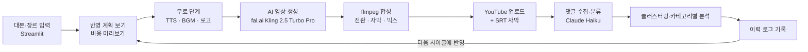

# AI 영상 생성 · 댓글 피드백 자동 반영 파이프라인

대본과 장르를 넣으면 AI 영상을 만들어 YouTube에 올리고, **댓글 피드백을 분석해 다음 영상에 자동으로 반영**하는 범용 파이프라인입니다.
국립군산대학교 임베디드소프트웨어학과 홍보영상을 사례로 검증했습니다.

## 한눈에 보기



## 핵심 아이디어

피드백을 전부 "영상 재생성"으로 처리하면 비용이 크고 결과도 불안정합니다.
그래서 **피드백을 종류별로 나누고, 합성 단계에서 바꿀 수 있는 것은 영상을 다시 만들지 않고** 처리합니다.

| 피드백 종류 | 예시 댓글 | 처리 방식 | 영상 생성 비용 |
|---|---|---|---|
| 영상 내용 | "장면 1에서 자동차가 안 움직여요" | 해당 장면만 프롬프트 수정 후 재생성 | 장면당 $0.35 |
| 화면 보정 | "너무 어두워요" | 밝기·대비·색감·선명도 후처리 | 없음 |
| 음악·목소리 크기 | "음악이 커요" | 볼륨 조절 | 없음 |
| 자막 | "자막이 작아요", "유튜브 자막이 좋아요" | 크기·위치·색 조절, SRT 자막 업로드 | 없음 |
| 자막-음성 불일치 | "자막과 음성이 안 맞아요" | 자막을 나레이션 문장에 맞춤 | 없음 |
| 로고 | "로고가 빈 화면에 나왔으면" | 페이드아웃 후 엔드카드, 크기·위치 | 없음 |
| 나레이션 | "대사가 딱딱해요" | AI가 문장을 다듬고 **사람이 승인한 것만 적용** | 없음 |
| 장면 삭제·순서·페이드 | "장면 2 빼주세요" | 합성 순서·페이드 변경 | 없음 |
| 반영 불가 | 스토리 변경 등 | 건너뛰고 이력에 기록 | 없음 |

## 비용 통제

- **클립 캐시**: 같은 프롬프트의 클립은 재사용합니다.
- **계획 미리보기**: 생성 전에 새로 만들 클립 수와 예상 비용을 보여줍니다.
- **무료 단계 선행**: TTS·BGM·로고를 먼저 처리해, 실패해도 영상 비용이 나가지 않습니다.
- **생성 상한**: 한 번에 새로 만드는 클립 수에 상한이 있습니다.
- **업로드 실패 대비**: 영상은 보관되고 비용 없이 재시도할 수 있습니다.

## 실험 결과 (cycle 40 → 41)

기준 영상에 달린 댓글 6건을 분석해 다음 영상에 반영했습니다.

| 댓글 요지 | 처리 | 반영 |
|---|---|---|
| 노래 소리를 줄이면 좋겠다 | 배경음악 볼륨 0.3 → 0.231 | 반영 |
| 마지막 자막과 음성 순서가 안 맞다 | 장면 4 자막을 나레이션과 일치 | 반영 |
| 내부 자막 디자인이 별로, 유튜브 자막이 좋다 | 자막을 영상에서 빼고 SRT로 업로드 | 반영 |
| 마지막 로고가 페이드아웃 후 빈 화면에 나오면 좋겠다 | 흰 화면으로 페이드아웃 후 로고 | 반영 |
| AI 음성이 더 자연스러우면 좋겠다 | 문장 표현만 다듬음 (음성 품질은 그대로) | 부분 반영 |
| AI 음성보다 직접 녹음이 좋겠다 | 녹음 미지원, 남성 TTS로 대체 | 부분 반영 |

- 완전 반영 4건, 부분 반영 2건 (6건 중 완전 반영 66.7%)
- 새로 생성한 클립 0개, **추가 영상 생성 비용 $0**
- 반영 범위 밖: "학과만의 색이 약하다"처럼 영상 방향 전체를 바꾸는 의견

## 기술 스택

Python · Streamlit · fal.ai(Kling 2.5 Turbo Pro) · edge-tts · ffmpeg · YouTube Data API · Claude Haiku · ko-sroberta + KMeans

## 구조

```
app.py              Streamlit 화면
pipeline/runner.py  사이클 계획·실행 (plan_cycle, run_generation_cycle)
compose/            ffmpeg 합성, 자막, TTS, BGM, 설정
feedback/           댓글 분류·클러스터링·카테고리별 분석
youtube/            업로드, 댓글 수집
input/              대본·BGM·로고 관리
data/logs/pipeline_history.jsonl   사이클별 반영 이력
```

## 실행

```bash
python -m venv .venv
.venv\Scripts\activate        # macOS/Linux: source .venv/bin/activate
pip install -r requirements.txt
streamlit run app.py
```

API 키는 `.env`에 넣고 저장소에 올리지 않습니다.

## 한계

- AI 영상 모델은 같은 프롬프트라도 결과가 달라지고, 지시를 그대로 따르지 않을 수 있습니다.
- 무료 TTS(edge-tts)라 음성의 자연스러움에 한계가 있고, 직접 녹음은 미구현입니다.
- LLM 분류가 의도와 어긋날 수 있어, 반영 전에 "반영 계획 보기"에서 사람이 확인합니다.
- 반복 검증은 현재 2사이클이며, 3회 이상으로 늘려 반영률을 갱신할 예정입니다.
